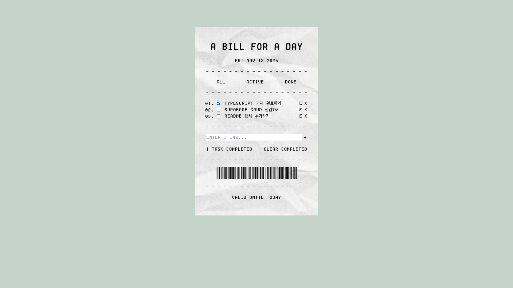
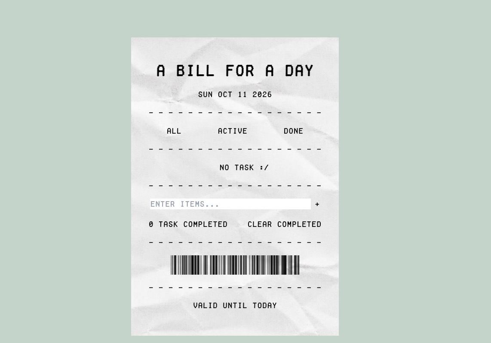
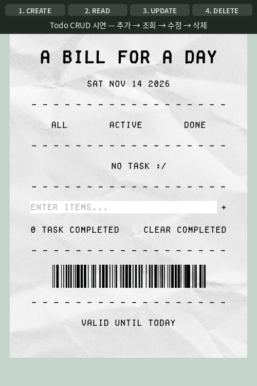
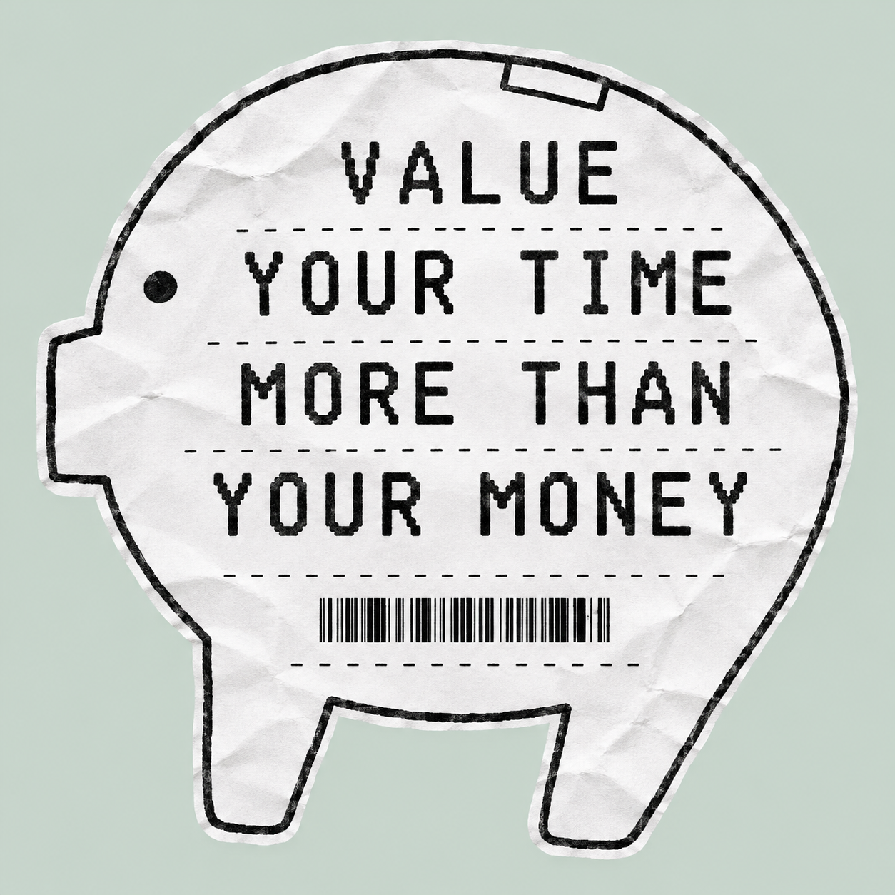

# A Bill for a Day

오늘 해야 할 일을 영수증의 항목처럼 기록하고, 완료한 일들을 하나씩 정산하는 Todo List입니다. 하루 동안 추가한 할 일은 브라우저에 저장되어 페이지를 다시 열어도 이어서 확인할 수 있습니다.

KANT AX Engineer 과정 CH2 프론트엔드 개발 평가 과제로 제작했습니다.

**배포 주소:** <https://mjlee0914.github.io/javascript-todo-list/>

## 구현 화면

### 할 일 목록



### 빈 목록



## CRUD 기능 시연



브라우저에서 할 일의 추가·조회·수정·삭제를 한 흐름으로 실행한 시연 영상입니다. 상단 표시줄에 현재 단계가 나타납니다.

1. **추가(Create)**: 입력창에 `Buy milk`, `Read a book`, `Walk the dog`를 입력하고 `+`를 눌러 추가합니다.
2. **조회(Read)**: 추가한 할 일 3개가 목록에 표시되고, 새로고침한 뒤에도 `localStorage`에서 불러와 그대로 유지됩니다.
3. **수정(Update)**: 첫 번째 항목의 `E`를 누르고 입력창(prompt)에 새 내용을 입력해 `Buy milk`를 `Buy oat milk`로 고칩니다.
4. **삭제(Delete)**: `Read a book` 항목의 `x`를 눌러 삭제하고, 남은 할 일 2개를 확인합니다.

## 목차

- [A Bill for a Day](#a-bill-for-a-day)
  - [구현 화면](#구현-화면)
    - [할 일 목록](#할-일-목록)
    - [빈 목록](#빈-목록)
  - [CRUD 기능 시연](#crud-기능-시연)
  - [목차](#목차)
  - [프로젝트 소개](#프로젝트-소개)
  - [주요 기능](#주요-기능)
  - [버튼 설명](#버튼-설명)
  - [사용 기술](#사용-기술)
  - [로컬에서 실행하기](#로컬에서-실행하기)
  - [폴더 구조](#폴더-구조)
  - [과제 제출 전 확인](#과제-제출-전-확인)
    - [선택 사항](#선택-사항)
  - [원본 작업 위치](#원본-작업-위치)

## 프로젝트 소개

`A Bill for a Day`는 하루가 끝나기 전 오늘의 시간을 어떻게 사용했는지 돌아볼 수 있도록 만든 영수증 컨셉의 Todo List입니다. 해야 할 일을 영수증의 주문 항목처럼 적고, 체크한 일은 완료 내역으로 정산합니다.

날짜, 항목 번호, 구분선, 바코드와 `valid until today` 문구를 활용해 한 장의 실제 영수증처럼 구성했습니다. 돼지저금통 모양의 파비콘에는 작은 할 일을 하나씩 끝내며 소중한 시간을 차곡차곡 모은다는 의미를 담았습니다.



## 주요 기능

- 할 일을 추가하고, 수정하고, 삭제할 수 있습니다.
- 할 일의 완료 여부를 표시할 수 있습니다.
- 전체, 진행 중, 완료된 할 일만 골라 볼 수 있습니다.
- 완료된 할 일을 한 번에 삭제할 수 있습니다.
- 할 일은 브라우저의 `localStorage`에 저장됩니다.
- 오늘 날짜와 완료한 할 일 수를 보여줍니다.

## 버튼 설명

| 화면에 보이는 것  | 하는 일                              |
| ----------------- | ------------------------------------ |
| `All`             | 모든 할 일을 보여줍니다.             |
| `Active`          | 아직 끝내지 않은 할 일을 보여줍니다. |
| `Done`            | 끝낸 할 일을 보여줍니다.             |
| 체크박스          | 할 일의 완료 상태를 바꿉니다.        |
| `+`               | 입력한 할 일을 목록에 추가합니다.    |
| `E`               | 해당 할 일의 내용을 고칩니다.        |
| `x`               | 해당 할 일을 삭제합니다.             |
| `clear completed` | 끝낸 할 일을 모두 삭제합니다.        |

## 사용 기술

- HTML
- CSS
- JavaScript
- Tailwind CSS 3

## 로컬에서 실행하기

필요한 CSS 파일이 포함되어 있습니다. 저장소의 최상위 폴더에서 아래 명령어를 실행하세요.

```sh
python3 -m http.server 8000
```

그다음 브라우저에서 <http://localhost:8000>을 여세요.

## 폴더 구조

```text
./
├── assets/
│   ├── fonts/
│   │   └── Fake Receipt.otf  # 영수증 스타일 글꼴
│   ├── barcode.png            # 영수증 하단 바코드
│   ├── favicon.ico            # 돼지저금통 파비콘
│   ├── image.png              # 영수증 종이 배경
│   └── value-your-time-receipt-pig.png  # 프로젝트 컨셉 이미지
├── css/
│   ├── style.css              # 사용자 정의 스타일
│   ├── tailwind-input.css     # Tailwind CSS 입력 파일
│   └── tailwind.css           # 빌드된 Tailwind CSS
├── js/
│   └── todo.js                # Todo CRUD 및 저장 로직
├── screenshots/
│   ├── todo-crud-demo.gif     # 추가·조회·수정·삭제 시연 영상
│   └── todo-list.png          # 할 일이 표시된 실행 화면
├── index.html                 # 애플리케이션 메인 화면
├── main.png                   # 빈 목록 실행 화면
├── package.json               # 프로젝트 및 개발 의존성 정보
├── package-lock.json          # npm 의존성 잠금 파일
├── tailwind.config.js         # Tailwind CSS 설정
└── README.md
```

## 과제 제출 전 확인

- [x] 개인 Public 저장소로 분리
- [x] CRUD 기능 및 미리 보기 이미지 포함
- [x] 할 일이 표시된 실행 화면 캡처 포함
- [x] 추가·조회·수정·삭제 시연 영상 첨부

### 선택 사항

- [x] GitHub Pages 배포 주소 추가

## 원본 작업 위치

이 저장소는 팀 실습 저장소에서 이명지가 작성한 Todo 폴더를 개인 과제 제출용으로 분리한 저장소입니다.

- [팀 저장소의 원본 작업 폴더](https://github.com/aiagentohms/todo_list_3th/tree/main/mjlee)
